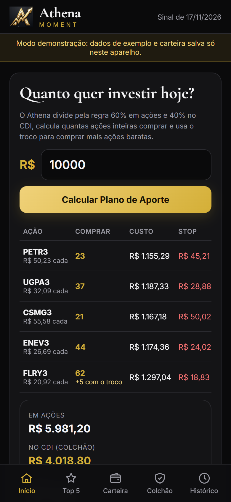
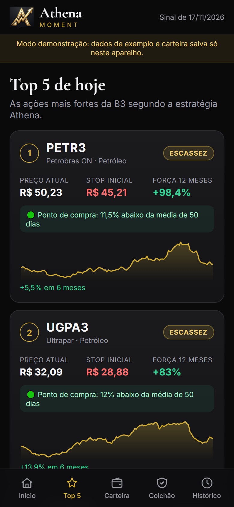
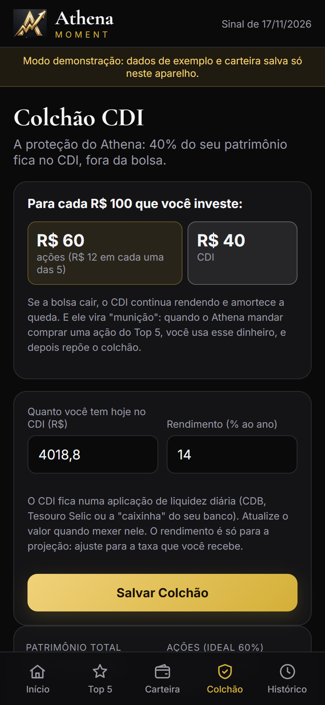

# 🏛️ Athena Moment

**Triagem de ações da B3 com uma estratégia de momentum validada em backtest.**
Todo dia útil, depois do fechamento, um robô analisa 75 ações do Ibovespa, escolhe as 5 mais fortes e o app mostra o que fazer: o que comprar, o que vender e onde está o risco da sua carteira.

**📱 Abrir o app:** [giovanssouzagt-lang.github.io/athena-moment](https://giovanssouzagt-lang.github.io/athena-moment/) (instalável no celular como aplicativo)

<p align="center">
  
  
  
  
</p>

> ⚠️ Ferramenta de triagem e estudo. **Não é recomendação de investimento.** Resultados passados não garantem resultados futuros.

---

## A estratégia

O Athena nasceu de uma pesquisa com **26 versões de backtest**. Foram testados, entre outros, compra de ações "baratas", filtros de mercado, fatores de qualidade e baixa volatilidade, stops fixos e por ATR, tamanhos de carteira e a tese de escassez. A versão vencedora combina:

| Regra | Como funciona |
|---|---|
| **Força** | Retorno de ~12 meses (252 pregões), ignorando o último mês (21 pregões). Só entram ações com retorno positivo. |
| **Escassez** | Entre as 10 mais fortes, empresas de recursos finitos (petróleo, mineração, energia, saneamento, papel) passam na frente. |
| **Diversificação** | No máximo 2 ações por setor, e a mesma empresa só entra uma vez (PETR3 e PETR4 contam como Petrobras). |
| **Respiro (timing)** | Ação mais de 8% acima da média de 50 dias está "esticada" e é pulada; a próxima do ranking entra no lugar. |
| **Stop móvel** | 10% abaixo do maior preço desde a compra. O stop sobe junto com a ação e nunca desce. |
| **Colchão** | 60% do patrimônio em ações e 40% no CDI (liquidez diária). |

**Resultado no backtest v26 (2021–2026):** CAGR ~22% ao ano · queda máxima −8,5% · rebalanceamento mensal com custos de transação e IR.
Sem o colchão e o timing (v21): CAGR ~20% · queda máxima ~18% · Sharpe 1,06.

**Limitações conhecidas, levadas a sério:**
- A configuração v26 (colchão 40%, stop 10%, timing 8%) foi a melhor entre **45 combinações** testadas no mesmo período. Parte do resultado pode ser específica desse período (*overfitting*); ela ainda não passou por validação fora da amostra.
- O Sharpe de 1,82 calculado no v26 **não desconta a taxa livre de risco**. Como 40% fica no CDI, rendendo um valor estável, o número fica inflado e não é comparável ao Sharpe de um fundo.
- Os preços usados já são **ajustados por proventos**: o retorno do backtest **já inclui os dividendos**. Somar dividendos por fora seria contá-los duas vezes.
- O universo é a composição **atual** do Ibovespa. Empresas que saíram do índice no período não entram no teste (viés de sobrevivência), o que tende a melhorar o resultado.
- A vantagem do momentum enfraqueceu em 2025–2026, segundo a análise de Sharpe em janela móvel.
- O período testado é curto (cinco anos), limitado pelos dados gratuitos.

## Mesma estratégia, código novo: e provado

Este repositório é uma reconstrução dos scripts originais (`athena_final.py` e `athena_app.py` v26). Para garantir que nada mudou na lógica validada:

- **604 testes automáticos** comparam a versão nova com cópias fiéis das originais em 300 mercados sorteados, sem timing (`athena_final.py`) e com timing (v26). O Top 5 é idêntico em todos.
- Com **dados reais**, as séries de preço e o Top 5 também são idênticos (`tests/comparar_dados_reais.py`).
- O download ficou **13× mais rápido**: as 75 ações numa chamada só, em ~1,7 s contra ~23 s.
- Os testes rodam **antes de cada sinal diário**. Se a estratégia mudar sem querer, o robô para.

## Como funciona

```
GitHub Actions (18h30, dias úteis)        Supabase                         App (GitHub Pages, PWA)
┌───────────────────────────────┐   ┌──────────────────────────┐   ┌────────────────────────────┐
│ 1. testes (pytest)            │   │ sinais (Top 5 por dia)   │   │ login por e-mail e senha   │
│ 2. baixa preços (Yahoo)       │   │ precos (para o stop)     │   │ Início: simulador + alertas│
│ 3. roda a estratégia (Python) │──▶│ ia_conteudo (notícias e  │◀──│ Top 5 · Carteira · Colchão │
│ 4. envia sinal e preços       │   │   relatórios da IA)      │   │ Histórico · Relatórios     │
│ 5. notícias com o Gemini (IA) │   │ aportes e caixa_cdi      │   │ Notícias nos cartões       │
├───────────────────────────────┤   │ (por usuário, com RLS)   │   │ BOVA11                     │
│ Sexta, 19h30: relatório       │   │                          │   │                            │
│ semanal com o Gemini (IA)     │   │                          │   │                            │
└───────────────────────────────┘   └──────────────────────────┘   └────────────────────────────┘
```

- **Estratégia:** Python, pandas, yfinance (pasta `athena/`)
- **Banco e login:** Supabase (PostgreSQL) com Row Level Security: cada usuário só enxerga as próprias anotações e o próprio colchão (`supabase/`)
- **IA:** Gemini, no plano gratuito do Google AI Studio, chamado pela API REST (`athena/ia.py`)
- **App:** React + Vite, PWA instalável no celular, gráficos em SVG sem bibliotecas (pasta `web/`)
- **Automação:** GitHub Actions publica o app, gera o sinal diário e o relatório de sexta (`.github/workflows/`)

### O app
O Athena não compra nada sozinho: ele é a "cola" do investidor. As compras e vendas são feitas na corretora e **anotadas** no app, que acompanha tudo.

- **Simulador "Quanto quer investir hoje?":** divide o valor em 60/40, calcula quantas ações inteiras comprar de cada uma do Top 5 e usa o troco para comprar mais ações baratas. Com um toque, anota as compras e soma a parte do CDI ao colchão.
- **"O que fazer hoje":** alertas que explicam o motivo e o próximo passo:
  - 🔴 **Vender pelo stop móvel:** a ação caiu 10% desde o topo
  - ⚠️ **Saiu do Top 5:** a estratégia gira o capital para as ações mais fortes
  - ⚠️ **Colchão alto ou baixo:** o CDI fugiu dos 40% (tolerância de 15%), com a ação de menor lucro sugerida para vender
  - ⚠️ **Concentração alta:** um setor passou de 40% das ações
  - 🟢 **Comprar:** ação do Top 5 que ainda não está na carteira
- **Carteira:** anotações de compra e venda, preço médio, lucro em aberto e realizado, e o stop móvel de cada posição
- **Colchão CDI:** quanto deveria estar no CDI, a divisão atual e a projeção de juros
- **Top 5:** selo de "ponto de compra" ou "respiro", gráfico de 6 meses e comparativo com o BOVA11
- **Histórico:** o Top 5 de cada dia e o ranking completo, incluindo as ações puladas por estarem esticadas

### Athena Inteligente (IA gratuita)
Um complemento com o **Gemini** (plano gratuito do Google AI Studio). A IA **explica e informa**: ela nunca muda o Top 5 nem recomenda comprar ou vender.

- **Notícias do dia:** depois do sinal, o robô busca manchetes recentes (Google Notícias) das ações do Top 5 e das ações anotadas nas carteiras. A IA classifica o risco (nenhum, atenção ou alto) e o app mostra o resumo nos cartões e um alerta no Início quando há risco.
- **Relatório semanal:** toda sexta às 19h30, um resumo da semana com as mudanças no Top 5, os destaques, os riscos e o que acompanhar. Ele aparece no Histórico.
- **Segurança:** o texto das notícias é tratado como dado e nunca como instrução. A resposta segue um formato fixo (JSON), e tickers que não foram pedidos são descartados. Nenhum dado da carteira é enviado à IA, só tickers e manchetes públicas.
- **Se a IA falhar** (sem chave, limite do plano gratuito ou instabilidade), o sinal do dia já foi salvo e o robô termina normalmente.

## Quando os dados atualizam

O Athena usa o **preço de fechamento** de cada pregão, não cotações em tempo real, porque a estratégia foi testada assim e preços do meio do dia gerariam alarmes falsos de stop. O robô roda **uma vez por dia útil, às 18h30**: o sinal de um dia serve para operar no pregão seguinte, e o app não muda durante o pregão.

A data no topo do app é a do **último fechamento usado**. Feriados, fins de semana e atrasos da fonte de dados (Yahoo Finance) estão explicados, com um exemplo real, em **[Quando os dados do Athena são atualizados](docs/quando-os-dados-atualizam.md)**.

## Rodar localmente

```bash
# Estratégia
python -m venv .venv
.venv\Scripts\activate            # Windows
pip install -r requirements.txt
pytest                            # 604 testes de equivalência
python gerar_sinal.py             # gera saida/ultimo_sinal.json

# App (sem chaves do Supabase, abre em modo demonstração)
cd web
npm install
npm run dev
```

Para usar com banco: crie um projeto no Supabase, rode `supabase/schema.sql`, `supabase/002_v26.sql` e `supabase/003_ia.sql` (nessa ordem) no SQL Editor e crie `web/.env.local` com `VITE_SUPABASE_URL` e `VITE_SUPABASE_ANON_KEY`. O robô usa `SUPABASE_URL`, `SUPABASE_SERVICE_KEY` e, para a Athena Inteligente, `GEMINI_API_KEY` (chave gratuita em [aistudio.google.com](https://aistudio.google.com)), num `.env` na raiz ou nos *Secrets* do GitHub. Opcional: `GEMINI_MODELO` troca os modelos, separados por vírgula (padrão: `gemini-3.5-flash,gemini-3.5-flash-lite`; o segundo assume se o primeiro falhar). Nenhuma chave secreta fica no código.

## Autoria

Estratégia, pesquisa (26 versões de backtest), regras de negócio e design por **Giovan Souza**, com desenvolvimento assistido por IA (Claude Code).
