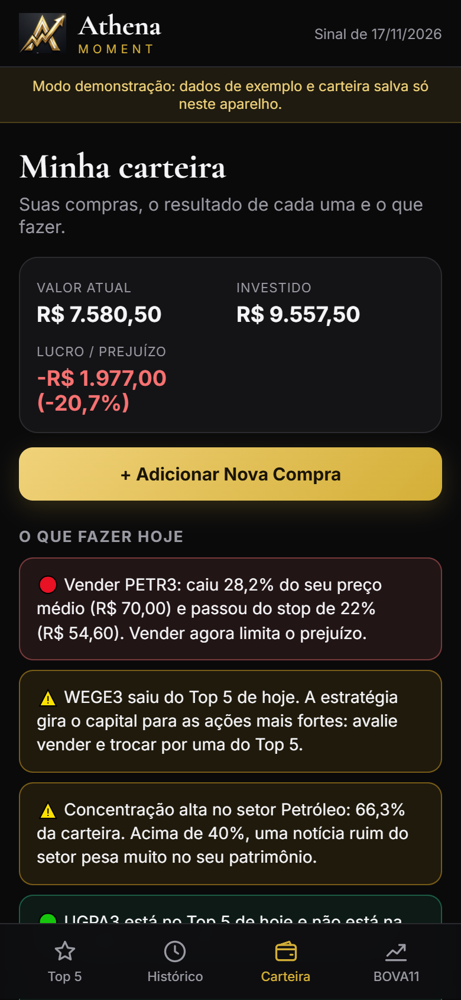
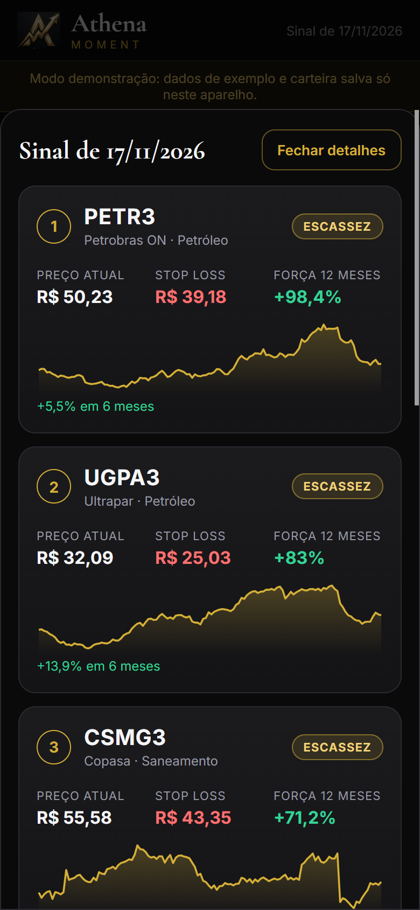
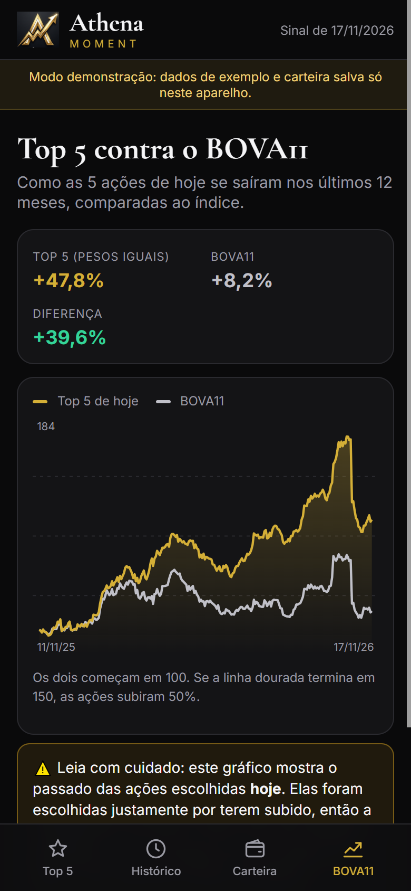

# 🏛️ Athena Moment

**Triagem de ações da B3 com uma estratégia de momentum validada em backtest.**
Todo dia útil, depois do fechamento, um robô analisa 75 ações do Ibovespa, escolhe as 5 mais fortes e o app mostra o que fazer: o que comprar, o que vender e onde está o risco da sua carteira.

<p align="center">
  
  
  
  
</p>

> ⚠️ Ferramenta de triagem e estudo. **Não é recomendação de investimento.** Resultados passados não garantem resultados futuros.

---

## A estratégia

O Athena nasceu de uma pesquisa com **26 versões de backtest**. Foram testados, entre outros, compra de ações "baratas", filtros de mercado, fatores de qualidade e baixa volatilidade, stops fixos e por ATR, tamanhos de carteira e a tese de escassez. A versão vencedora combina:

| Regra | Como funciona |
|---|---|
| **Força** | Retorno de ~12 meses (252 pregões), ignorando o último mês (21 pregões). Só entram ações com retorno positivo. |
| **Escassez** | Entre as 10 mais fortes, empresas de recursos finitos (petróleo, mineração, energia, saneamento, papel) passam na frente. |
| **Diversificação** | No máximo 2 ações por setor, e a mesma empresa só entra uma vez (PETR3 e PETR4 contam como Petrobras). |
| **Proteção** | Stop loss 22% abaixo do preço. |

**Resultado no backtest (2021–2026):** Sharpe 1,06 · CAGR ~20% ao ano · queda máxima ~18% · rebalanceamento mensal com custos de transação.

**Limitações conhecidas, levadas a sério:**
- O universo é a composição **atual** do Ibovespa. Empresas que saíram do índice no período não entram no teste (viés de sobrevivência), o que tende a melhorar o resultado.
- A vantagem da estratégia enfraqueceu em 2025–2026, segundo a análise de Sharpe em janela móvel.
- O período testado é curto (cinco anos), limitado pelos dados gratuitos.

## Mesma estratégia, código novo: e provado

Este repositório é uma reconstrução do script original (`athena_final.py`). Para garantir que nada mudou na lógica validada:

- **303 testes automáticos** comparam a versão nova com uma cópia fiel da original em 300 mercados sorteados. O Top 5 é idêntico em todos.
- Com **dados reais**, as séries de preço e o Top 5 também são idênticos (`tests/comparar_dados_reais.py`).
- O download ficou **13× mais rápido**: as 75 ações numa chamada só, em ~1,7 s contra ~23 s.
- Os testes rodam **antes de cada sinal diário**. Se a estratégia mudar sem querer, o robô para.

## Como funciona

```
GitHub Actions (18h30, dias úteis)        Supabase                       App (GitHub Pages, PWA)
┌───────────────────────────────┐   ┌────────────────────────┐   ┌───────────────────────────┐
│ 1. testes (pytest)            │   │ sinais (Top 5 por dia)  │   │ login por e-mail e senha  │
│ 2. baixa preços (Yahoo)       │──▶│ ativos (75 ações)       │◀──│ Top 5 · Histórico         │
│ 3. roda a estratégia (Python) │   │ aportes (por usuário,   │   │ Carteira · BOVA11         │
│ 4. envia o sinal              │   │   protegidos por RLS)   │   │ alertas explicativos      │
└───────────────────────────────┘   └────────────────────────┘   └───────────────────────────┘
```

- **Estratégia:** Python, pandas, yfinance (pasta `athena/`)
- **Banco e login:** Supabase (PostgreSQL) com Row Level Security: cada usuário só enxerga as próprias compras (`supabase/schema.sql`)
- **App:** React + Vite, PWA instalável no celular, gráficos em SVG sem bibliotecas (pasta `web/`)
- **Automação:** GitHub Actions publica o app e gera o sinal diário (`.github/workflows/`)

### Alertas da carteira
O app explica o motivo de cada alerta, em vez de só mostrar números:
- 🔴 **Vender pelo stop:** a ação caiu 22% abaixo do seu preço médio
- ⚠️ **Saiu do Top 5:** a estratégia gira o capital para as ações mais fortes
- ⚠️ **Concentração alta:** um setor passou de 40% da carteira
- 🟢 **Oportunidade:** ação do Top 5 que ainda não está na carteira

## Rodar localmente

```bash
# Estratégia
python -m venv .venv
.venv\Scripts\activate            # Windows
pip install -r requirements.txt
pytest                            # 303 testes de equivalência
python gerar_sinal.py             # gera saida/ultimo_sinal.json

# App (sem chaves do Supabase, abre em modo demonstração)
cd web
npm install
npm run dev
```

Para usar com banco: crie um projeto no Supabase, rode `supabase/schema.sql` no SQL Editor e crie `web/.env.local` com `VITE_SUPABASE_URL` e `VITE_SUPABASE_ANON_KEY`. O robô usa `SUPABASE_URL` e `SUPABASE_SERVICE_KEY` (num `.env` na raiz, ou nos *Secrets* do GitHub). Nenhuma chave secreta fica no código.

## Autoria

Estratégia, pesquisa (26 versões de backtest), regras de negócio e design por **Giovan Souza**, com desenvolvimento assistido por IA (Claude Code).
